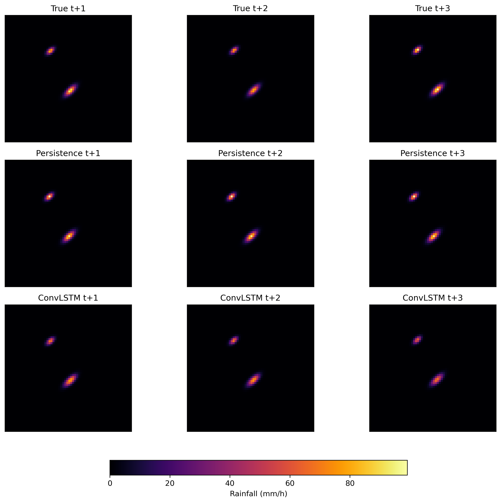
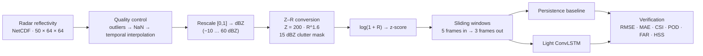
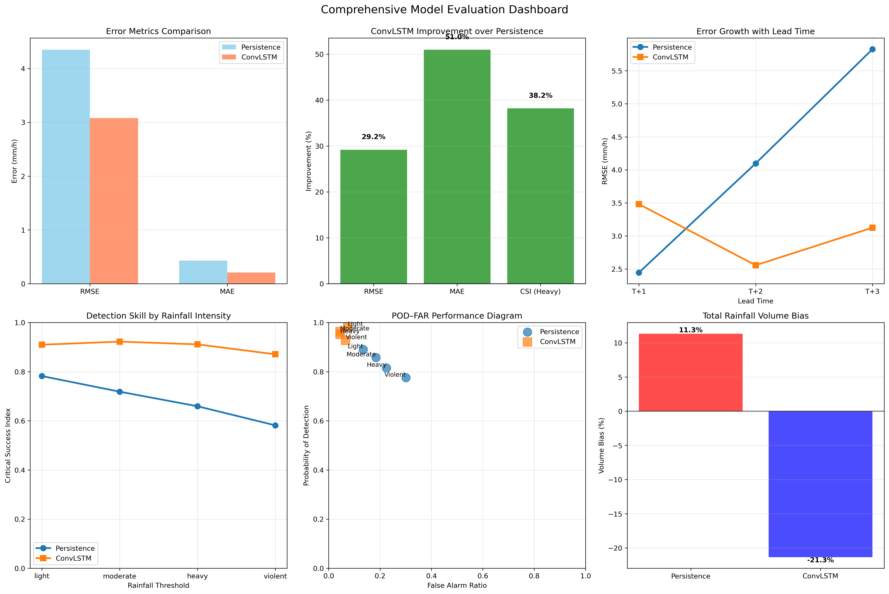
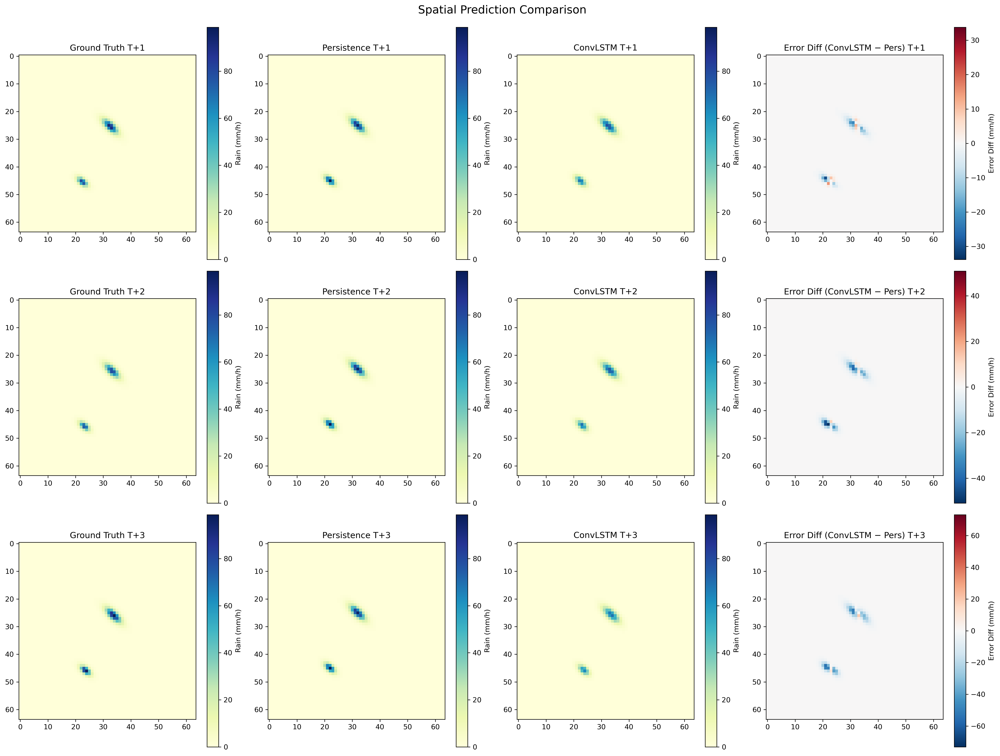
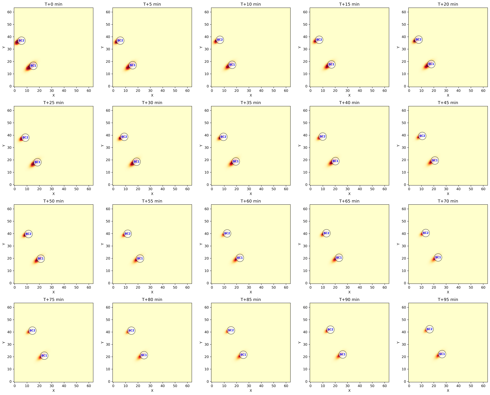
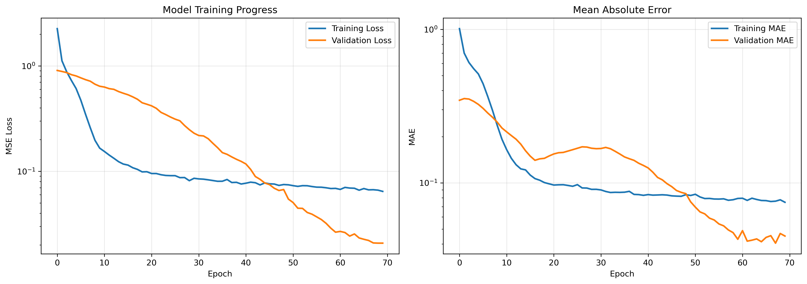
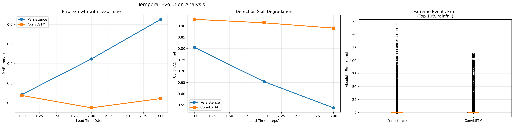
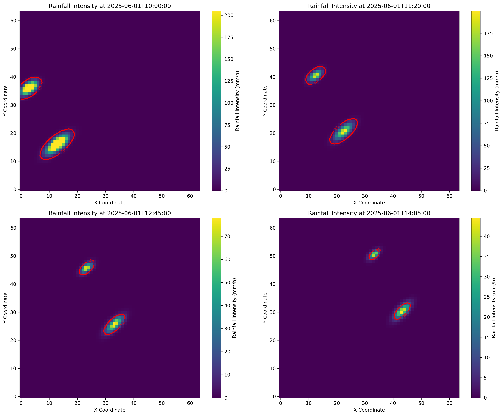

<div align="center">

# Alpine Radar Precipitation Nowcasting with ConvLSTM

**Forecasting the next 15 minutes of rainfall from weather-radar images with deep learning**

[](https://github.com/Niloufarbeikahmadi/Alpine-Radar-Precipitation-Nowcasting-ConvLSTM/actions/workflows/tests.yml)


[](LICENSE)

</div>

<p align="center">
  
  <br>
  <em>Observed rainfall (top), persistence forecast (middle) and ConvLSTM forecast (bottom) at +5, +10 and +15 min for a test case.</em>
</p>

## Overview

**Nowcasting** means forecasting precipitation for the next few minutes to
hours. Flash-flood warnings, urban drainage and road safety all depend on it.
This project builds an end-to-end pipeline that:

1. turns raw **radar reflectivity** from a convective storm over the **Alpine region** into physically meaningful **rain rates (mm/h)**,
2. learns how storm cells move and change with a **lightweight ConvLSTM** (a spatio-temporal recurrent neural network),
3. **verifies** the forecasts against a persistence baseline, using the continuous and categorical scores that operational weather services use.

### Headline results

On held-out test sequences, forecasting the next 3 radar frames (+5, +10 and +15 min):

| | Persistence | **ConvLSTM** | Change |
|---|---:|---:|---:|
| RMSE (mm/h) | 4.35 | **3.08** | **−29 %** |
| MAE (mm/h) | 0.43 | **0.21** | **−51 %** |
| Heavy-rain CSI (≥ 7.5 mm/h) | 0.66 | **0.91** | **+0.25** |
| Heavy-rain false-alarm ratio | 0.22 | **0.04** | **−80 %** |
| Pixel correlation | 0.83 | **0.96** | +0.13 |

## Contents

- [Data](#data)
- [Methodology](#methodology)
- [Results](#results)
- [Repository structure](#repository-structure)
- [Getting started](#getting-started)
- [Limitations and future work](#limitations-and-future-work)
- [Skills demonstrated](#skills-demonstrated)

---

## Data

| Property | Value |
|---|---|
| Source | Weather-radar reflectivity, single convective episode, Alpine region |
| Format | NetCDF: `reflectivity(time, y, x)` |
| Coverage | 50 frames every **5 min** (2025-06-01, 10:00 → 14:05), 64 × 64 grid |
| Delivered as | Min–max scaled reflectivity in [0, 1] |
| Derived rain rate | 0 – 205 mm/h (mean 0.97 mm/h); 1.75 % of pixels ≥ 7.5 mm/h |

The raw radar file is not redistributed. The **model-ready sequences** used
for training are included in [`data/processed/`](data/processed). See
[`data/README.md`](data/README.md) for the exact format.

## Methodology



### 1 · Exploratory analysis and pre-processing

- **Structure validation.** Checks the variables, dimensions, coordinates and the 5-min time step.
- **Quality control.** Values outside −10 to 75 dBZ are flagged. Gaps are filled pixel by pixel through time.
- **Physics-based target.** Scaled reflectivity is mapped back to dBZ. It is then converted to rain rate with the **Marshall–Palmer Z–R relation** (Z = 200·R^1.6). Echoes below 15 dBZ are treated as clutter (no rain).
- **Learning-friendly scaling.** `log(1 + R)` compresses rain rates that span several orders of magnitude. A z-score then stabilises training.
- **Framing.** Sliding windows of **25 min of history → next 15 min** give 43 sequences, split 30 / 6 / 7 for train / validation / test.
- **EDA figures.** Storm life cycle, rain-rate distributions, spatial snapshots with 10 mm/h storm-core contours, and automatic **storm-cell labelling** (connected components) over a 20-frame time-lapse.

### 2 · Model development

Three architectures were tried, from largest to smallest. The small dataset decided the winner:

| Variant | Design | Parameters | Outcome |
|---|---|---:|---|
| U-Net ConvLSTM | Encoder–decoder, 64–128 filters, down/up-sampling, skip connections | 5,758,273 | ❌ Over-fitted; forecasts collapsed to "no rain" |
| Moderate ConvLSTM | 3 blocks, 32 → 32 → 16 filters, L2 = 1e-4 | 140,049 | Intermediate |
| **Light ConvLSTM** | **3 blocks, 16 → 16 → 8 filters, L2 = 5e-5** | **35,465** | ✅ **Adopted: stable and best skill** |

```
Input  (5 × 64 × 64 × 1)  z-scored log(1+R)
 ├─ ConvLSTM2D 16 · 3×3 · tanh · L2 5e-5 → BatchNorm → Dropout 0.25
 ├─ ConvLSTM2D 16 · 3×3 · tanh · L2 5e-5 → BatchNorm → Dropout 0.25
 ├─ ConvLSTM2D  8 · 3×3 · tanh · L2 5e-5 → BatchNorm → Dropout 0.25
 ├─ keep last 3 time steps
 └─ TimeDistributed Conv2D 1×1 · linear
Output (3 × 64 × 64 × 1)  → inverse transform → mm/h
```

**Training set-up:** MSE loss, Adam (lr 1e-3, gradient clipping 1.0), batch size 4,
70 epochs, early stopping (patience 10, best weights restored),
ReduceLROnPlateau (×0.5, patience 4), fixed random seeds.
The **linear output head** on z-scored log-rain avoids sigmoid saturation and
keeps the intensity gradients that matter for heavy rain.

**Baseline:** Eulerian **persistence** (the last observed frame is repeated).
It is simple, but it is a strong reference at very short lead times.

### 3 · Verification

| Family | Scores | Why |
|---|---|---|
| Continuous | MSE, RMSE, MAE, bias, normalised RMSE/MAE, correlation | Pixel-level intensity accuracy (mm/h) |
| Categorical at 0.1 / 2.5 / 7.5 / 25 / 50 mm/h | POD, FAR, **CSI**, HSS | Event detection, which forecasters and emergency managers act on |
| Lead time | RMSE, MAE and CSI at T+1 … T+3 | How fast skill decays |
| Spatial & volume | Pattern correlation, domain-total volume bias | Realistic structure and water balance for hydrology |

## Results

All scores are on the held-out test set (7 sequences × 3 lead times × 64 × 64 pixels), in physical units.

**Detection skill across intensities (CSI)**

| Threshold | Light (0.1) | Moderate (2.5) | Heavy (7.5) | Violent (25) | Extreme (50 mm/h) |
|---|---:|---:|---:|---:|---:|
| Persistence | 0.78 | 0.72 | 0.66 | 0.58 | 0.49 |
| **ConvLSTM** | **0.91** | **0.92** | **0.91** | **0.87** | **0.84** |

**Error by lead time (RMSE, mm/h)**

| Lead time | +5 min | +10 min | +15 min |
|---|---:|---:|---:|
| Persistence | **2.45** | 4.10 | 5.83 |
| ConvLSTM | 3.48 | **2.56** | **3.13** |

**Key findings**

- The ConvLSTM gives **more accurate intensities and much sharper event detection** than persistence. Heavy-rain CSI is 0.91 vs 0.66, and the false-alarm ratio is 5× lower.
- **Its advantage grows with lead time.** Persistence is hard to beat at +5 min, but its error grows 2.4× by +15 min, while the ConvLSTM stays stable. This suggests the network has learned how cells move and evolve, rather than copying the last frame.
- **On small data, model size matters most.** A 5.8 M-parameter U-Net memorised the training set. The 35 k-parameter ConvLSTM generalised.
- **Trade-off:** the ConvLSTM underestimates total rain volume (−21 %, vs +11 % for persistence). This is the known smoothing effect of an MSE loss, and it is addressed in future work.

<table>
  <tr>
    <td align="center"><br><sub>Evaluation dashboard: errors, lead time, CSI, POD–FAR, volume bias</sub></td>
    <td align="center"><br><sub>Spatial errors per lead time (blue = ConvLSTM better)</sub></td>
  </tr>
  <tr>
    <td align="center"><br><sub>EDA: automatic storm-cell labelling every 5 min</sub></td>
    <td align="center"><br><sub>Training and validation curves (70 epochs)</sub></td>
  </tr>
  <tr>
    <td align="center"><br><sub>Skill vs lead time and extreme-event errors</sub></td>
    <td align="center"><br><sub>EDA: rainfall snapshots with 10 mm/h storm cores</sub></td>
  </tr>
</table>

The full metric set (80 scores) is in [`outputs/metrics/`](outputs/metrics). The
written report is [`docs/Precipitation_Nowcasting_Report.pdf`](docs/Precipitation_Nowcasting_Report.pdf).

## Repository structure

```
Alpine-Radar-Precipitation-Nowcasting-ConvLSTM/
├── src/radar_nowcasting/        # Python package
│   ├── config.py                #   all paths & hyper-parameters in one place
│   ├── preprocessing.py         #   Task 1: QC, Z–R conversion, scaling, sequences
│   ├── eda_plots.py             #   Task 1: exploratory figures
│   ├── baseline.py              #   persistence forecast
│   ├── models.py                #   Task 2: light / moderate / U-Net ConvLSTM
│   ├── training.py              #   Task 2: callbacks, diagnostics, learning curves
│   ├── nowcaster.py             #   Task 2: NowcastingModels workflow
│   ├── metrics.py               #   verification scores (CSI, POD, FAR, HSS, …)
│   ├── evaluation.py            #   Task 3: StormNowcastingEvaluation + reports
│   ├── evaluation_plots.py      #   Task 2/3: forecast and diagnostic figures
│   ├── pipeline.py              #   run_task1 / run_task2 / run_task3
│   └── synthetic.py             #   synthetic radar cube for tests and demos
├── scripts/                     # command-line entry points
│   ├── run_eda.py   train.py   evaluate.py   run_pipeline.py
├── tests/                       # unit, regression and end-to-end tests (pytest)
├── data/
│   ├── raw/                     #   radar_data.nc goes here (not tracked)
│   └── processed/               #   model-ready sequences + scaler (tracked)
├── outputs/
│   ├── figures/{eda,training,evaluation}/
│   ├── metrics/                 #   JSON / CSV / TXT evaluation reports
│   ├── models/                  #   best_nowcasting_model.h5 (trained weights)
│   └── predictions/             #   test-set forecasts (.npz)
├── docs/                        # project report and engineering notes
├── .github/workflows/tests.yml  # CI: lint + tests on every push
├── requirements.txt
└── pyproject.toml
```

## Getting started

### Installation

```bash
git clone https://github.com/Niloufarbeikahmadi/Alpine-Radar-Precipitation-Nowcasting-ConvLSTM.git
cd Alpine-Radar-Precipitation-Nowcasting-ConvLSTM

python -m venv .venv
source .venv/bin/activate          # Windows: .venv\Scripts\activate
pip install -r requirements.txt
pip install -e .                    # optional: makes `radar_nowcasting` importable everywhere
```

### Reproduce the reported results (about 10 s, CPU only)

```bash
python scripts/evaluate.py          # re-scores the shipped test forecasts → outputs/metrics/
```

### Retrain or run the whole pipeline

```bash
python scripts/train.py                          # adopted light ConvLSTM on data/processed/
python scripts/train.py --architecture unet      # reproduce the rejected U-Net experiment
python scripts/run_pipeline.py                   # Task 1 → 2 → 3 from data/raw/radar_data.nc

# No radar file? A full demo on synthetic storms, written to demo_run/
python scripts/run_pipeline.py --synthetic --epochs 3
```

### Use the trained model in Python

```python
from radar_nowcasting.models import load_trained_model
from radar_nowcasting.preprocessing import inverse_transform_predictions
from radar_nowcasting.utils import load_task1_results

X, y, scaler = load_task1_results()  # (43, 5, 64, 64, 1) sequences
model = load_trained_model("outputs/models/best_nowcasting_model.h5")

rain_mm_h = inverse_transform_predictions(model.predict(X[:1]), scaler)  # (1, 3, 64, 64, 1)
```

### Run the tests

```bash
pytest
```

The 24 tests cover the Z–R conversion, gap filling, normalisation round-trips,
the verification scores and all three architectures. They also include
**regression tests**: the shipped weights must reproduce the shipped forecasts,
and re-scoring those forecasts must reproduce the published metrics. A final
end-to-end test runs Task 1 → 2 → 3 on synthetic data.
How the code was reorganised from the original research script, and how
equivalence was checked, is described in
[`docs/refactoring_notes.md`](docs/refactoring_notes.md).

## Limitations and future work

| Limitation | Planned direction |
|---|---|
| One storm event, about 30 training sequences | More events, data augmentation (rotation, scaling, temporal noise), chronological splits across events |
| MSE loss blurs forecasts and underestimates peaks and volume | Probabilistic loss (negative log-likelihood, mean + variance), or an adversarial (GAN) discriminator for sharper fields |
| Persistence is a weak benchmark beyond a few minutes | **Optical-flow advection** baseline (Lucas–Kanade / Farnebäck) |
| One fixed Z–R relation and linear un-scaling of reflectivity (±5–10 dBZ uncertainty) | Storm-type and season-dependent Z–R; quantile mapping to a radar climatology |
| Radar is the only input | Condition on NWP fields (wind, CAPE, humidity); physics-informed regularisation |
| Deterministic, small 64 × 64 domain | Ensembles or uncertainty estimates, larger domains, transfer learning |

## Skills demonstrated

`Weather-radar processing` · `NetCDF / xarray` · `Hydrometeorology (Z–R relation)` ·
`Spatio-temporal deep learning (ConvLSTM)` · `TensorFlow / Keras` ·
`Model selection on small data` · `Forecast verification (CSI, POD, FAR, HSS)` ·
`Data visualisation` · `Reproducible ML (seeds, configs, regression tests)` ·
`Modular Python packaging · CLI · CI`

## Author

**Niloufar Beikahmadi**, data scientist working on precipitation, hydrology and machine learning.
GitHub: [@Niloufarbeikahmadi](https://github.com/Niloufarbeikahmadi)

## License

Released under the [MIT License](LICENSE).
